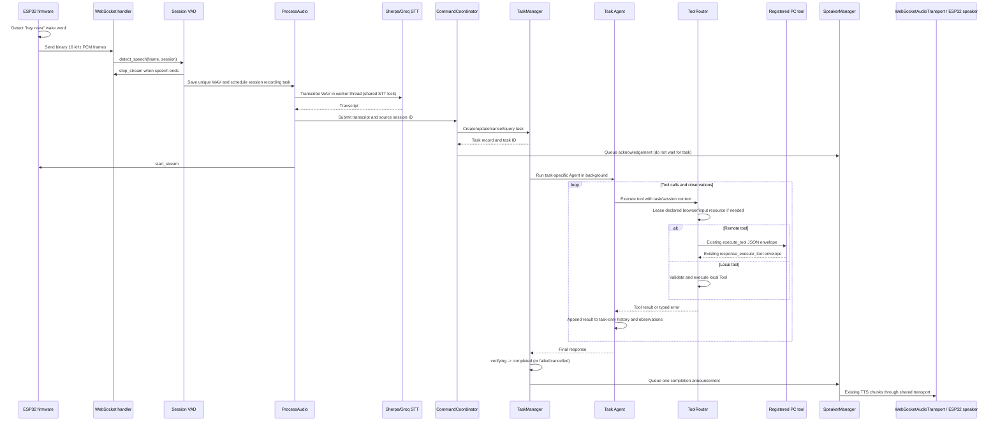

# NOVA Runtime Flow

This document describes the Python server and ESP32 firmware currently in this
repository. It distinguishes implemented runtime paths from integrations that
can be supplied by a connected PC remote-tool client.

## Chronological command and response flow

### 1. ESP32 wake-word detection

The active wake-word implementation is in `Hardware/MCU.txt`. ESP32 firmware
runs continuous Edge Impulse keyword spotting and starts microphone streaming
after the `hey nova` label crosses its confidence threshold. The Python module
`app/wake/wakeword.py` is a separate desktop microphone prototype; `app/main.py`
does not start it.

### 2–4. Audio transmission, reception, and VAD

The firmware sends binary mono PCM frames at 16 kHz over its WebSocket. The
server enters `app/communication/websocket.py:handle_client`, creates a
`ClientSession`, and passes ESP binary messages to `app/vad/vad_detection.py`.
Each session owns a `VADSessionState` with its own VAD instance, pre-buffer,
speech counters, and audio bytes. At speech end, VAD sends `stop_stream` to that
session's socket.

### 5–7. Recording, ProcessAudio, and STT

`ClientSession.submit_recording` writes a uniquely named WAV under `data/temp`
and schedules a tracked processing task. The processing task removes its
recording in `finally` and is cancelled during session cleanup. `ProcessAudio`
serializes a session's recording turns and calls the existing transcription
adapter through a worker thread. `main.py` shares an STT lock because the
transcription/model path is shared. `ProcessAudio._transcribe` tries the
existing Sherpa-backed `app.stt.whisper` path and falls back to its cloud path
when the local model is unavailable.

### 8–10. Command Coordinator, task selection, and scheduling

`CommandCoordinator.submit` handles transcript intake. It uses structured
keywords and task metadata to select a status query, a cancellation, an update
to the latest matching active task, or a new task. Music and email/Gmail terms
are currently the task categories; other requests are `general`. This is a
small deterministic dispatcher, not an LLM intent classifier.

`TaskManager` assigns a UUID task ID and stores a `TaskRecord` in its in-memory
registry. New work moves through accepted, planning, and queued before a
background asyncio worker starts. The coordinator queues an acknowledgement
and returns without waiting for the task's LLM or remote tool work. Cancelling
or updating one task does not acquire the manager's registry lock while the
old worker retires, so unrelated task intake can continue.

### 11–12. Task Agent, tools, and remote execution

Every task gets a separate `Agent` object and separate `messages` history. The
shared Groq client, `ToolRegistry`, `ToolRouter`, `PendingRequests`, resource
coordinator, synthesizer, and transport are application services. Task
observations are appended to that task's `TaskRecord`; task updates and task
memory stay on that record.

The Agent calls the shared router with `task_id`, tool-call ID, and an optional
status callback. The router validates arguments and leases only a tool's
declared resource. Remote tools retain the existing schema and JSON message
protocol. The task ID is stored in the local pending request record and is not
added to the remote wire payload. A server-generated PC connection ID remains
associated with each registered `RemoteTool` and pending call, preserving
remote connection ownership checks. Remote timeout, cancellation, response,
and disconnect behavior remains in `RemoteTool` and `PendingRequests`.

### 13. Browser observations and feedback loops

No native browser manager or browser tool is implemented in this checkout.
Browser capabilities can be registered by a connected PC remote-tool client.
When a browser-named tool includes `tab_id`/`tabId`, the shared resource
coordinator leases that tab; browser calls without a tab ID use one conservative
browser-wide lease. Tool results return to the originating Agent and become
that task's tool-result history and observation record. Each task therefore
continues its own observe/act loop without sharing conversation history.

### 14–15. Lifecycle and speech output

The TaskManager marks the task verifying before speaking its final result and
completed after the announcement finishes. Failures are marked failed and
attempt one failure announcement. Cancellation increments a task generation;
late callbacks from retired workers are ignored. Updating a task starts a new
Agent from the task's last committed history, so a cancelled partial turn is
not reused.

`SpeakerManager` is a single application-owned priority queue and worker. It
serializes coordinator acknowledgements, task results, and failure speech over
the existing `speak` → TTS queue/consumer → selected audio transport path. Queued
speech can be cancelled by task ID; active playback for that task is cancelled
through the existing async `speak` wrapper. Higher priority requests are chosen
before requests still waiting in the queue. Playback already in progress is not
preempted by priority alone.

The runtime defaults to `WebSocketAudioTransport`, which resolves the active ESP
connection for each playback and streams PCM chunks to it. Set
`NOVA_AUDIO_TRANSPORT=local` to use `LocalAudioTransport` on the host computer.
Both transports stay available as interchangeable runtime options. ESP32
playback requires a connected device that implements the `audio_start`, binary
PCM, and `audio_end` message sequence.

## Ownership and concurrency

| Object | Ownership | Shared or isolated |
| --- | --- | --- |
| `ToolRegistry`, `ToolRouter`, `PendingRequests` | `NovaRuntime` | Shared |
| Groq client | `Agent` class singleton | Shared client; each Agent supplies separate messages |
| `ResourceCoordinator` | `NovaRuntime` / `ToolRouter` | Shared keyed locks |
| `SpeakerManager`, synthesizer, output transport | `NovaRuntime` | Shared, one playback worker |
| `ClientSession`, VAD state, recording paths, processing tasks | WebSocket connection | Per connection |
| `TaskRecord`, Agent, history, observations, memory | `TaskManager` task ID | Per task |
| `PendingRequests` entry | Remote tool call | Task ID plus server connection ID; ESP session ID remains available for legacy session-owned calls |

Tasks execute as independent asyncio workers. Model calls, remote calls, and
local computations without a declared exclusive resource do not share a global
execution lock. Tools may declare resource keys; the router acquires keys in
sorted order and releases them even on cancellation. The fallback rules
serialize browser calls by tab (or globally if the tab is unknown) and
mouse/keyboard/computer-input calls on `physical-input`.

Task IDs are generated by `TaskManager`; they travel from `TaskRecord` to the
task Agent, `ToolExecutionContext`, `ToolRouter`, and local pending request
metadata. They are not sent to remote clients, so the established protocol is
unchanged. Session IDs identify the audio source and are retained as task
metadata; task work is application-owned rather than cancelled merely because
its originating ESP session closes.

## Errors and cleanup

- VAD/session cleanup resets per-session buffers, cancels tracked recording
  processing, removes temporary WAVs, and cancels legacy session-owned pending
  calls.
- A task cancellation retires only that task's worker, cancels its queued or
  active speech, and invalidates late status/observation callbacks by generation.
- Agent turn cancellation restores its pre-turn history and propagates
  `CancelledError`; blocking model work may finish in its worker thread before
  that task worker exits.
- Resource leases release in `finally` when tool execution returns, fails, or
  is cancelled.
- A remote PC disconnect rejects calls owned by that server connection ID and
  unregisters only that socket's remote tools.
- Runtime shutdown cancels task workers, closes ESP sessions, and closes the
  shared speaker worker.

## Current integration limits

The application currently registers calculator and time tools locally.
Browser, Gmail, and other PC capabilities depend on a remote client registering
those tools. The existing `app/audio/player.py:download_and_play` helper is not
registered as an active tool and does not currently play its converted WAV.
`ToolExecutionContext.register_side_effect` lets a task-aware integration
register an async cancellation callback for a persistent effect; no built-in
music integration currently uses it. Thus the task runtime supports owning and
cancelling registered effects, but cannot stop an opaque effect from an
unmodified remote tool that exposes no cancellation hook.

Task-aware tools can also call `ToolExecutionContext.request_user_input(prompt)`.
The TaskManager moves that task to `waiting_for_user`, sends the prompt through
the shared speaker, and routes the next ordinary transcript back to that task.
No current built-in tool uses clarification requests.
