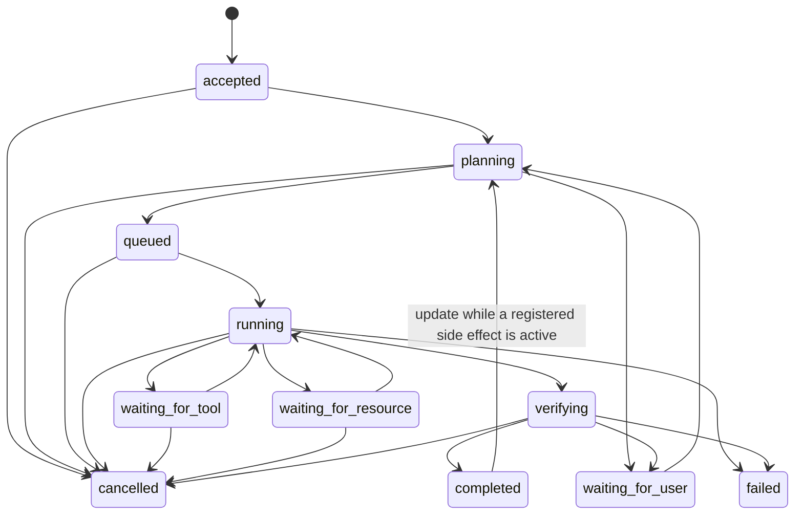

# Task Lifecycle

`TaskManager` owns task IDs, task records, isolated Agent instances, background
workers, and state transitions. `CommandCoordinator` chooses an operation and
returns after scheduling it. The shared `ToolRouter` and `SpeakerManager` remain
outside task ownership.

## State machine

Valid edges are enforced by `TaskRecord.transition`. The manager currently
creates a task through accepted → planning → queued synchronously; its worker
then enters running. `ToolRouter` reports waiting-for-tool and
waiting-for-resource while calls are in flight. On return, the task enters
verifying and becomes completed after its completion speech finishes.

`waiting_for_user` is entered when a task-aware tool calls
`ToolExecutionContext.request_user_input(prompt)`. The speaker asks the
question, and the next ordinary user command is routed back as that task's
answer. No current built-in tool requests clarification; the coordinator does
not infer this state from model text.

## Creation and isolated execution

1. The coordinator classifies the request as `music`, `email`, or `general`.
2. `TaskManager.create` generates a UUID and stores a `TaskRecord`.
3. The runtime factory creates a new `Agent` for that task. The Agent receives
   shared registry/router/client services, but owns its message history and
   run lock.
4. The task manager starts a named asyncio worker and returns the record to the
   coordinator without awaiting task execution.
5. Each tool call receives `task_id` and task status/observation callbacks.
   `PendingRequests` stores the task ID alongside the existing remote call
   metadata. The remote payload remains unchanged.

Task records retain instruction, category, source session, result/error, task
memory, tool observations, history snapshot, announcement state, worker, and
optional persistent-effect cancellation callbacks. Status queries return
structured snapshots from the manager registry.

## Updates

The coordinator updates the latest matching active task for a replacement
music command such as “Play Badshah instead.” It cancels only that task's worker,
increments its generation, cancels its speech, stops registered persistent
effects, and creates a fresh Agent from the last committed task history. The
old worker is retired asynchronously; stale callbacks are ignored. Agent turn
rollback prevents partial tool-call history from becoming the committed
snapshot. Other tasks do not wait on the replaced worker.

Terminal tasks cannot be changed unless they still own a registered persistent
effect. In that case an update first invokes that effect's cancellation
callback, then returns the task to planning with its same task ID and history.

## Cancellation and persistent effects

Cancelling an active task invalidates its generation, cancels its worker and
task-associated speech, invokes task-owned effect cancellation callbacks, and
marks the task cancelled. Cancellation does not cancel unrelated task workers
or shared application services. The manager tracks retired workers so runtime
shutdown can await their cleanup.

A tool can register an effect through
`ToolExecutionContext.register_side_effect(effect_id, async_cancel_callback)`.
Completed tasks may keep such an effect active. A later stop/cancel request
invokes that callback while leaving the execution status completed; the side
effect is then removed from task ownership. An update can stop the effect and
reuse the same task ID. No current built-in music tool registers an effect, so
this mechanism is an integration boundary, not a claim that the existing music
helper has become a working player.

## Resource ownership and scheduling

Tasks are scheduled as independent asyncio workers; there is no single global
task execution lock. The ToolRouter leases a resource only for operations that
declare one. Browser calls use `browser-tab:<tab_id>` when a tab identifier is
present and a conservative global browser key otherwise. Recognized physical
input calls use one `physical-input` lease. Independent API and computational
tools do not acquire those leases. Leases are acquired in sorted key order and
released on success, failure, and cancellation.

## Failure handling and cleanup

- Tool validation/execution errors are returned through the existing typed
  tool boundary and recorded as tool observations by the Agent.
- Agent/model exceptions mark the task failed and attempt one failure
  announcement. `CancelledError` propagates and is not converted into a normal
  result.
- Remote timeout, remote disconnect, and response correlation remain in
  `RemoteTool` and `PendingRequests`; the connection ID is local metadata and
  no remote protocol fields changed.
- Task-specific speech is queued by the shared `SpeakerManager`; cancellation
  removes queued speech and cancels that task's active playback wrapper.
- Runtime shutdown cancels active task workers, waits for retired worker
  cleanup, closes sessions, and then closes the speaker worker.

## Current limits

The manager is in-memory and does not persist records across process restarts.
There is no built-in browser/Gmail tool or local music playback tool registered
by the server; those actions require a registered PC remote tool. Remote side
effects can only be stopped when the integration provides a cancellation
callback. Resource classification for remote tools uses the existing tool name
and arguments because the remote schema/protocol is intentionally unchanged.
