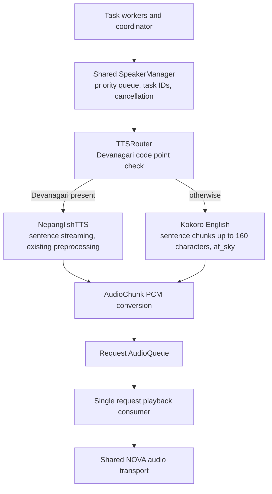

# NOVA TTS routing

NOVA keeps two speech engines because they have different strengths and
interfaces. Nepali speech uses the existing Piper/sherpa-onnx path, including
its Nepali number handling, mixed-script transliteration, sentence chunking,
and streaming interface. English uses the project's Kokoro ONNX voice and its
sentence based chunking with a maximum chunk length. Routing does not modify
the input text.

## Routing rule

`app/tts/tts_router.py` checks for characters in the Devanagari, Vedic
Extensions, Devanagari Extended, and Devanagari Extended-A Unicode blocks. If
any such character occurs, it selects Nepali. All other text selects English.
This is a script test, not a language detector: Romanized Nepali goes to
English. Empty input safely selects English and produces no chunks.

## Speech paths

Nepali requests retain the existing path:

1. The router selects the existing `NepanglishTTS` instance.
2. `synthesize_stream()` splits sentences and emits each generated waveform.
3. `tts_engine.synthesize_to_chunks()` converts samples to PCM16 `AudioChunk`s
   at the synthesizer's sample rate.
4. The request's bounded `AudioQueue` feeds the shared transport consumer.

English requests use the existing Kokoro model, voice `af_sky`, speed `1.1`,
and language `en-us`:

1. The router selects `KokoroEnglishTTS`.
2. Text is split at sentence punctuation (`.`, `?`, `!`) and newlines. Long
   sentences are split at word boundaries up to 160 characters per chunk.
3. Kokoro synthesizes each piece and yields its waveform as soon as that piece
   is ready. Kokoro returns a complete waveform per piece, not sample-level
   streaming; NOVA queues each piece while later pieces are synthesized.
4. The same PCM chunk conversion, queue consumer, and transport used by Nepali
   deliver the audio. The old standalone English queue/player thread is gone.

## Shared speaker and concurrency

`NovaRuntime` owns both synthesizers, one `TTSRouter`, the existing audio
transport, and one `SpeakerManager`. Task workers and coordinator announcements
continue to submit requests to that same speaker with their task IDs and
priorities. The speaker's priority queue selects a whole request at a time;
the request is synthesized and played before the next begins, so audio chunks
from separate requests cannot interleave. Each request selects its own engine
from its own text, so voice selection is not mutable shared request state.
Kokoro calls are guarded by an engine-local lock because its thread-safety is
not established. Speaker serialization also ensures a single playback
consumer.

Cancelling a task cancels its queued/active speech request using the existing
speaker lifecycle; it does not close the speaker or shared transport. A
synthesis exception is returned to that request and logged by SpeakerManager;
the worker continues serving later requests. Transport and speaker lifecycle
remain application-owned.

## Limitations

- Romanized Nepali contains no Devanagari code points and therefore routes to
  Kokoro English.
- Kokoro produces a complete waveform for each sentence or bounded text piece;
  it does not expose smaller streaming audio frames through this integration.
- The Kokoro model and voice files must be present under `models/`, and
  `kokoro-onnx` is an application dependency.
